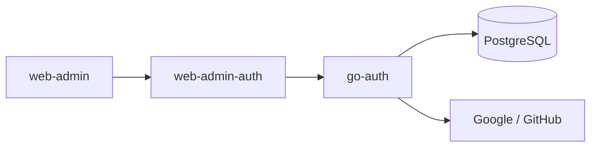

# go-auth

Authentication core for an SMB technology product. Build a sound technical core
first: clear contracts, secure access, correct data, and reliable operations.
Product features come after those gates pass. The UI operates the core's real
technical capabilities.



## Current state

Go, Gin, PostgreSQL, and shared `go-bedrock` modules. Redis is optional and
disabled by default. The module and Docker build declare Go 1.27.1.

The simplified schema has nine tables: clients, users, profiles, external
identities, login attempts, auth codes, sessions, roles, and user-role links.
One client row is one provider OAuth app; `(provider, client_id)` identifies it.
`client_ref` binds attempts, codes, and sessions to its UUID.

The auth flow and admin API use this simplified client model. The admin
implementation in `internal/iam` has been fully aligned with the 9-table schema
and verified against a disposable database. See the
[SMB core plan](specs/2026-10-17-smb-auth-core/00-overview.md) and
[execution status](specs/2026-10-17-smb-auth-core/04-execution-status.md).

## Boundaries

- `cmd/server`: startup, server execution, and private operator bootstrap subcommands (`bootstrap-client`, `bootstrap-admin`).
- `config`: embedded defaults and environment overrides.
- `internal/transport`, `handler`, `usecase`, `service`, `repository`: auth API.
- `internal/iam`: schema-aligned admin API (Users, Identities, Roles, Sessions, Registrations).
- `internal/bootstrap`: private operator bootstrap logic for initial client and initial admin.
- `migrations`: schema SQL; startup does not apply migrations automatically.
- `deploy/Dockerfile`: non-root container, API port 5050, ops port 4040.

Auth routes use `/api/auth/v1`; admin routes use `/api/admin/v1`.
`GET /health` and `GET /ready` are registered on the API. Readiness checks
PostgreSQL connectivity.

## Local development

Provide PostgreSQL, the declared Go toolchain, and shared module access.
Use [.env.example](.env.example) as a variable reference. The app reads process
environment; it does not load `.env` itself. Provider settings belong in
`clients`.

Set `POSTGRES__URL`, `AUTH__ISSUER`, `AUTH__PROVIDER_SECRET_KEY`, and
`AUTH__SIGNING_KEY__KEY_ID` plus the signing key path or PEM variable. Keep real
values outside the repo. Apply SQL only to an identified target; never reset an
existing database to match the initial migration.

```sh
go build ./...
go vet ./...
# Private operator bootstrap commands:
go run ./cmd/server bootstrap-client --help
go run ./cmd/server bootstrap-admin --help
```

## Delivery

Use the existing [infra](../infra/README.md) Compose stack and
[web-admin](../web-admin/README.md) with its cookie adapter. Antigravity (agy)
orchestrates task breakdown, phase gates, and review; Claude implements bounded tasks.
See the [execution status](specs/2026-10-17-smb-auth-core/04-execution-status.md).
