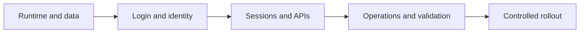
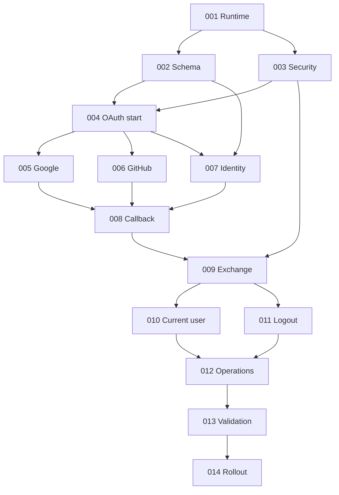

# Shared Auth Implementation Tasks

## Goal

Turn the accepted Shared Auth specs into small, reviewable tasks. The current repo is a server skeleton with `/health`; all auth and PostgreSQL work is still open.

## Status rules

- `TODO`: not started.
- `IN PROGRESS`: owned and being changed. Only one owner.
- `BLOCKED`: dependency or external input is missing. Add the reason under the task.
- `DONE`: merged and every done check passes.
- The tracker is the source of truth. Keep its status and the task checkbox aligned.
- Update `Owner` and `PR` when work starts. Update this file in the same PR as the task.

## Delivery flow

## Tracker

| ID | Task | Status | Depends on | Owner | PR |
|---|---|---|---|---|---|
| AUTH-001 | Runtime config and PostgreSQL pool | TODO | None | — | — |
| AUTH-002 | Schema and first-party clients | TODO | AUTH-001 | — | — |
| AUTH-003 | Security primitives and client auth | TODO | AUTH-001 | — | — |
| AUTH-004 | Login attempt and OAuth start | TODO | AUTH-002, AUTH-003 | — | — |
| AUTH-005 | Google provider authentication | TODO | AUTH-004 | — | — |
| AUTH-006 | GitHub provider authentication | TODO | AUTH-004 | — | — |
| AUTH-007 | Identity resolution transaction | TODO | AUTH-002, AUTH-004 | — | — |
| AUTH-008 | Provider callback and auth code | TODO | AUTH-005, AUTH-006, AUTH-007 | — | — |
| AUTH-009 | Code exchange and session JWT | TODO | AUTH-002, AUTH-003, AUTH-008 | — | — |
| AUTH-010 | Current user endpoint | TODO | AUTH-009 | — | — |
| AUTH-011 | Logout endpoint | TODO | AUTH-003, AUTH-009 | — | — |
| AUTH-012 | Logs, health, readiness, and hardening | TODO | AUTH-010, AUTH-011 | — | — |
| AUTH-013 | Integrated acceptance validation | TODO | AUTH-005–AUTH-012 | — | — |
| AUTH-014 | Deployment and controlled rollout | TODO | AUTH-012, AUTH-013 | — | — |

## Dependency graph

## Task details

### [ ] AUTH-001 — Runtime config and PostgreSQL pool

**Outcome:** The service starts with validated auth configuration and a managed `pgx` pool.

**Scope:**

- Add PostgreSQL, public issuer, trusted proxy, and environment-specific auth config.
- Create the pool during startup and close it during graceful shutdown.
- Fail startup when required production config is missing or unsafe.
- Keep secrets outside defaults, source, and startup logs.

**Done:**

- The process starts against a reachable PostgreSQL database.
- Bad production config fails before traffic is served.
- Shutdown closes HTTP and database resources cleanly.

**Trace:** Specs 01, 10, 11.

### [ ] AUTH-002 — Schema and first-party clients

**Outcome:** PostgreSQL enforces the core identity and session invariants.

**Scope:**

- Add versioned migrations for clients, users, external identities, login attempts, auth codes, and sessions.
- Use UUIDv7 primary keys and required foreign keys.
- Enforce unique non-null canonical email and unique provider plus subject.
- Add a safe way to seed a client with exact redirect URIs and an Argon2id secret hash.

**Done:**

- Migrations apply from an empty database and rollback through the chosen migration workflow.
- Database constraints reject duplicate canonical email and provider identity.
- No plaintext client secret is stored.

**Trace:** Specs 01–03, 05, 06.

### [ ] AUTH-003 — Security primitives and client auth

**Outcome:** Later endpoints share one strict security implementation.

**Scope:**

- Add UUIDv7, secure random state and nonce, PKCE `S256`, and email normalization helpers.
- Verify Argon2id client secrets from HTTP Basic or the two client headers.
- Reject mixed credential forms and return one non-sensitive failure.
- Load ES256 signing keys by `kid`, allow controlled rotation overlap, and validate the pinned algorithm and required claims.

**Done:**

- State and nonce contain at least 128 bits of cryptographic randomness.
- Invalid or mixed client credentials fail before state changes.
- Unknown `kid`, wrong algorithm, issuer, audience, or time claims fail closed.
- Secret values cannot be emitted by config or error logging.

**Trace:** Specs 01, 06, 10.

### [ ] AUTH-004 — Login attempt and OAuth start

**Outcome:** `GET /auth/login/:provider` starts only a valid, bound login attempt.

**Scope:**

- Validate provider, `client_id`, exact redirect URI, product state, and PKCE challenge.
- Persist a single-use login attempt with a ten-minute expiry, state, nonce, and approved return data.
- Redirect to the selected provider with minimum scopes.
- Reject unsupported providers and unsafe return targets before redirect.

**Done:**

- Valid Google and GitHub starts create bound login attempts.
- Plain PKCE, unknown clients, and non-exact redirect URIs are rejected.
- Parallel browser tabs receive independent state and nonce values.

**Trace:** Specs 04, 08, 10.

### [ ] AUTH-005 — Google provider authentication

**Outcome:** Google callback data becomes one trusted normalized claim set.

**Scope:**

- Exchange and validate Google OAuth proof.
- Validate signature, issuer, audience, expiry, nonce, and stable subject.
- Map verified email and optional name and avatar fields.
- Discard provider authorization material after callback processing.

**Done:**

- A valid controlled Google account produces the common provider claim contract.
- Forged, expired, wrong-audience, and wrong-nonce proof is rejected.
- Only a Google-verified email is marked eligible for linking.

**Trace:** Specs 04, 08, 10.

### [ ] AUTH-006 — GitHub provider authentication

**Outcome:** GitHub callback data becomes the same trusted normalized claim set.

**Scope:**

- Exchange and validate GitHub OAuth proof and stable account subject.
- Fetch email with the minimum scope required for login.
- Select only the primary verified email; allow email to remain absent.
- Map optional name and avatar fields and discard provider tokens.

**Done:**

- A valid controlled GitHub account produces the common provider claim contract.
- Invalid, expired, denied, and replayed flows are rejected.
- Private, missing, non-primary, or unverified email cannot trigger linking.

**Trace:** Specs 04, 08, 10.

### [ ] AUTH-007 — Identity resolution transaction

**Outcome:** Trusted provider claims resolve to one stable user without unsafe merges.

**Scope:**

- Resolve provider and subject before considering email.
- For a new identity, link only by exact normalized verified canonical email.
- Otherwise create the user and identity in one transaction.
- Handle uniqueness races with bounded transaction retry.
- Refresh allowed claim snapshots without moving identity ownership.

**Done:**

- Returning identity always keeps its existing user.
- Unverified or absent email creates a distinct user.
- Concurrent equal provider subjects converge on one identity and user.
- Concurrent new providers with one verified email converge on one user.

**Trace:** Specs 02, 03, 05, 10.

### [ ] AUTH-008 — Provider callback and authorization code

**Outcome:** A valid provider callback returns only a short-lived product code through the browser.

**Scope:**

- Implement `GET /auth/callback/:provider` around provider validation and identity resolution.
- Atomically consume the login attempt, persist identity resolution, and issue the code.
- Bind the code to the client, redirect URI, user, identity, and PKCE challenge with a two-minute expiry.
- Redirect only to the saved approved URI with original product state.
- Map failures to the four stable public error categories.

**Done:**

- Callback replay and expired login attempts create no usable code.
- Failure leaves no partial user, identity, code, or session state.
- Browser URLs contain no provider token, JWT, secret, or raw identity claim.

**Trace:** Specs 04, 05, 08, 10.

### [ ] AUTH-009 — Code exchange and session JWT

**Outcome:** `POST /auth/exchange` consumes one code and returns one active 30-day session.

**Scope:**

- Authenticate the product client before code lookup or mutation.
- Validate code expiry, one-time use, client, redirect URI, and PKCE verifier.
- Consume the code and create the PostgreSQL session atomically.
- Sign an ES256 JWT with `iss`, `aud`, `sub`, `iid`, `sid`, `iat`, and fixed `exp`.
- Return the JWT and minimal shared profile with `Cache-Control: no-store`.

**Done:**

- Reuse, wrong-client, wrong-redirect, expired, and bad-verifier exchange fails.
- A successful exchange creates one active session and cannot be replayed.
- PostgreSQL stores no JWT or signing key.
- JWT `sub`, `iid`, `aud`, `sid`, and expiry match the session row.

**Trace:** Specs 06, 08, 10.

### [ ] AUTH-010 — Current user endpoint

**Outcome:** `GET /auth/me` returns the minimal profile only for an active bound session.

**Scope:**

- Validate bearer JWT signature and registered claims.
- Load the active session and verify user, identity, client, and expiry binding.
- Return only `user_id`, `identity_id`, email, display name, and avatar URL.
- Return one `401` shape for missing, invalid, expired, revoked, or mismatched sessions.

**Done:**

- Active sessions return the expected minimal profile and `Cache-Control: no-store`.
- Altered claims and an identity not owned by the subject fail closed.
- No product authorization or provider token appears in the response.

**Trace:** Specs 06, 07, 10.

### [ ] AUTH-011 — Logout endpoint

**Outcome:** `POST /auth/logout` makes the current session unusable before success.

**Scope:**

- Authenticate the product client and validate the bearer JWT when present.
- Revoke the matching PostgreSQL session.
- Keep missing, stale, and already revoked sessions idempotent.
- Return `503` when revocation cannot be confirmed.

**Done:**

- A revoked JWT immediately fails `/auth/me`.
- Repeat logout returns `204` without more state changes.
- Invalid client credentials cannot revoke a session.
- Logout never deletes users, identities, or unrelated sessions.

**Trace:** Specs 06, 09, 10.

### [ ] AUTH-012 — Logs, health, readiness, and hardening

**Outcome:** The service is safe to operate and exposes clear dependency state.

**Scope:**

- Emit structured JSON auth events with correlation ID, public client ID, provider, stage, and status.
- Redact secrets, codes, JWTs, emails, cookies, URLs with credentials, and provider payloads.
- Keep `/health` as process health and add `/ready` for PostgreSQL and required config.
- Trust forwarded scheme and address data only from configured proxies.
- Add provider and client feature gates needed for rollout.
- Configure access-restricted authentication log retention for 30 days.

**Done:**

- PostgreSQL loss makes readiness fail but does not misreport process health.
- Provider outage does not make existing-session validation unready.
- Validation logs contain all required fields and no prohibited data.
- Insecure production requests and untrusted forwarded headers fail safely.

**Trace:** Specs 10, 11, 13.

### [ ] AUTH-013 — Integrated acceptance validation

**Outcome:** Repeatable checks prove the complete contract without relying only on provider mocks.

**Scope:**

- Automate API contract, database integration, concurrency, expiry, replay, and security-negative checks.
- Run controlled Google and GitHub staging flows.
- Verify shared identity across two clients and product-local authorization isolation.
- Record the pilot latency and availability baseline.

**Done:**

- All acceptance criteria in specs 01–12 have a recorded pass or a linked defect.
- Concurrent first-login cases leave no duplicate user or identity.
- Both real provider flows pass with exact staging redirect URIs.
- Logs from the checks contain no prohibited auth material.

**Trace:** Spec 12 and acceptance criteria from specs 01–11.

### [ ] AUTH-014 — Deployment and controlled rollout

**Outcome:** Shared Auth reaches steady state through reversible provider and client gates.

**Scope:**

- Provision PostgreSQL, secrets, ES256 keys, provider apps, and first-party clients.
- Deploy with all login gates disabled and verify schema, health, readiness, and logs.
- Run team pilot, then one product, then wider product adoption.
- Rehearse disabling a provider or client without deleting identity data.

**Done:**

- Each rollout stage observes the required 24-hour window.
- Promotion has no identity corruption, secret leakage, unresolved severity-one auth failure, or readiness failure.
- Rollback stops new login while preserving identity and session evidence.
- Every product keys local data by JWT `sub` and keeps authorization local.

**Trace:** Spec 13.

## Suggested work order

1. Start AUTH-001.
2. Run AUTH-002 and AUTH-003 in parallel after runtime wiring is stable.
3. Build AUTH-004, then run AUTH-005, AUTH-006, and AUTH-007 in parallel.
4. Complete AUTH-008 and AUTH-009.
5. Run AUTH-010 and AUTH-011 in parallel.
6. Finish operations, acceptance, and rollout in AUTH-012–AUTH-014.

## Milestone gates

| Milestone | Tasks | Gate |
|---|---|---|
| M1 — Foundation | AUTH-001–AUTH-003 | Runtime, schema, client auth, and signing rules are usable. |
| M2 — Trusted identity | AUTH-004–AUTH-008 | Both providers resolve one safe canonical identity and return one-time codes. |
| M3 — Authenticated APIs | AUTH-009–AUTH-011 | Exchange, current user, and logout enforce the PostgreSQL session. |
| M4 — Production ready | AUTH-012–AUTH-013 | Operational and full acceptance gates pass. |
| M5 — Adopted | AUTH-014 | Staged rollout reaches steady state. |
