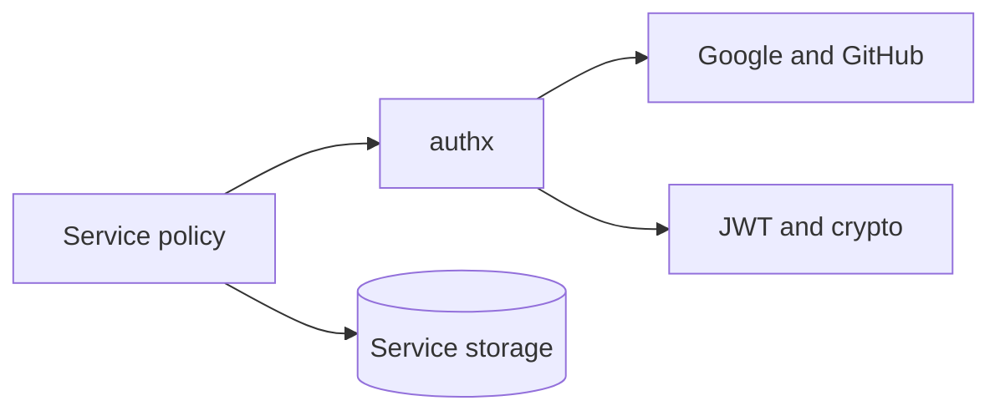
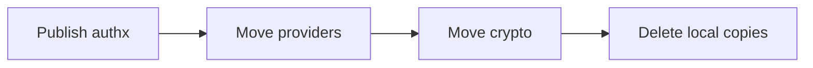

# Extract Reusable Authentication Logic into `authx`

## TL;DR

- **Goal:** Add an easy-to-use `authx` module to `go-bedrock`.
- **Key decision:** `authx` owns auth mechanisms; services own identity, storage, policy, and workflows.
- **Impact:** `go-auth` drops copied provider and crypto code without changing its API or data.

## Target boundary



`authx` is an independent `go-bedrock` module and must not import `go-auth`.

## Proposed public contract

```go
google, err := authx.NewGoogle(authx.GoogleConfig{ClientID: id, ClientSecret: secret})
loginURL, err := google.AuthorizationURL(authx.AuthorizationRequest{RedirectURI: callback, State: state, Nonce: nonce})
identity, err := google.Exchange(ctx, authx.ExchangeRequest{Code: code, RedirectURI: callback, Nonce: nonce})

tokens, err := authx.NewTokenManager(authx.TokenConfig{Issuer: issuer, ActiveKey: key})
signed, err := tokens.Sign(claims)
claims, err = tokens.Verify(signed, clientID)
```

Keep stable config on constructed objects and request values in method input.

## Scope

### In scope

| Item | Readiness | Contract |
|---|---|---|
| Provider adapters | **Ready** | Build authorization URLs, use minimal scopes, exchange codes, validate proof, and return one normalized `Identity`. |
| OAuth primitives | **Ready** | Generate opaque state, nonce, and codes; compute and verify PKCE `S256`. |
| Session JWT | **Assumption — review** | Sign and verify ES256 with `kid`, issuer, audience, time checks, and rotation overlap. Private claims remain service-defined. |
| Secrets | **Ready** | Hash and verify secrets with Argon2id safe defaults. |
| HTTP credentials | **Ready** | Parse Basic, client headers, and Bearer credentials through `net/http`; no Gin dependency. |
| Keys | **Ready** | Parse P-256 PEM keys and manage one active key plus verification keys. |

### Out of scope

- Identity resolution, email linking, users, profile ownership, and authorization.
- Login-attempt, auth-code, and session persistence or revocation.
- Databases, caches, transactions, routes, response mapping, and auth event policy.
- Redirect allowlists, TTL policy, environment detection, and secret loading.
- Gin middleware, proxy trust, and service configuration.

## Review decisions

| Decision | Why |
|---|---|
| Start with one `authx` module | It gives consumers one simple import. Split only after real dependency conflicts appear. |
| Move provider URL creation with callback validation | Both parts define one provider protocol. Leaving either in the service splits ownership. |
| Use typed config structs | They prevent swapped positional values and allow safe extension. |
| Allow an optional `http.Client` | Nil gets a bounded default; services may supply shared transport policy. |
| Keep issuer and keys in `TokenManager` | Callers configure security policy once, then use short sign and verify calls. |
| Return stable sentinel errors | Callers can map failures without parsing provider detail or leaking secrets. |

> **Warning**
> Do not move the current JWT claims unchanged. UUID validation and `iid` are `go-auth` rules, not shared token rules.

## Behavior

- **Safe by default:** Constructors reject missing credentials, invalid keys, and insecure algorithms.
- **Provider-neutral:** Google and GitHub return provider, subject, email verification, name, and avatar. Provider tokens are never returned.
- **Fail closed:** Invalid proof, plain PKCE, mixed credentials, unknown keys, and invalid claims return stable errors.
- **No hidden policy:** `authx` does not create users, choose allowed redirects, set service TTLs, or link identities.

## Migration order



1. Publish provider adapters and primitives.
2. Move provider URL and callback proof handling together.
3. Move JWT, PKCE, random values, secret hashing, and credential parsing.
4. Delete local copies after `go-auth` uses the released module.

## Impact and risks

- **Compatibility:** No endpoint, payload, database, or public error category changes.
- **Dependencies:** Exclude Gin, Viper, PostgreSQL, Redis, and all service domain types.
- **Risk:** Environment-aware key loading would couple `authx` to one app. Keep loading in the service.
- **Risk:** One package may grow wide. Revisit subpackages only when a second consumer proves the need.

## Acceptance criteria

- One provider object creates the login URL and exchanges the callback.
- One token manager signs and verifies without repeated issuer or key input.
- Provider tokens, secrets, and raw payloads never cross the package boundary.
- `go-auth` behavior stays unchanged after local helpers are replaced.
