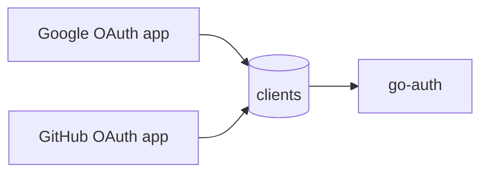

# One OAuth App per Client Row

## TL;DR

- **Goal:** Keep `clients`, merge provider settings into it, and remove `client_providers`.
- **Key decision:** Each row represents one Google/GitHub OAuth app. Its public `client_id` comes from that provider.
- **Impact:** Schema, admin API, backend credentials, session binding, and app integration change together.

## One registration, one row

A website using both providers has two rows. Operators create registrations at the provider, then save their settings in PostgreSQL.

## Contract changes

| Boundary | New contract |
|---|---|
| `clients` | Keep UUID `id`, name, timestamps, and approved `redirect_uris`. Add `provider`, encrypted provider `client_secret_enc`, `redirect_url`, and `enabled`. |
| Public identity | `client_id` is the provider-issued ID, widened to `VARCHAR(255)`. Replace global uniqueness with `UNIQUE(provider, client_id)`. |
| Backend authentication | Rename the existing hash to `auth_secret_hash`, separate from the provider secret. |
| Login | Keep `GET /api/auth/v1/login/:provider`; query `client_id` now means the provider-issued ID. |
| Admin | Replace both existing client routes with `PUT /api/admin/v1/clients/:provider/:client_id`. Body: `name`, `client_secret`, `auth_secret`, `redirect_url`, `redirect_uris`, `enabled`. |
| Authenticated APIs | Keep `/exchange`, `/me`, `/profile`, `/logout`. Add `X-Client-Provider`; credentials carry the provider-issued ID and backend `auth_secret`. |
| Persistent binding | Login attempts, auth codes, and sessions use `client_ref UUID`, a foreign key to `clients.id`, replacing their logical `client_id`. New JWT `aud` is that row UUID. |
| Initial migration | Edit the existing initial up/down SQL directly. The service has not been deployed; no upgrade migration or data backfill is needed. |

The UUID is a database key, not another public client ID. Callback routes stay unchanged; stored login state identifies the registration.

## Scope

### In scope

| Item | Readiness | Outcome |
|---|---|---|
| Single client table | **Ready** | One row per provider registration; no provider mapping table. |
| API and session binding | **Ready** | Requests, codes, sessions, and JWT audiences identify the same registration. |
| Backend authentication | **Ready** | Keep existing authentication per OAuth app row, without a separate logical client. |
| Initial migration | **Ready** | User confirmed no deployment. Update the existing migration directly; no old-data transition. |
| Docs and checks | **Ready** | Update integration guidance and verify both providers and registration isolation. |

### Out of scope

- Logical clients, shared registrations across websites, provider-console automation, Redis caching, identity-linking changes, and new unit tests.
- Data backfills, old-token compatibility, API compatibility aliases, and deployment work.

## Review decisions

| Decision | Why |
|---|---|
| Replace contracts before deployment | No legacy compatibility layer is needed. Integration examples use provider-issued IDs and the provider header. |
| UUID session audience | Bind tokens to one registration, including when providers issue identical client IDs. |
| Keep two redirect settings | `redirect_url` returns provider results to go-auth; `redirect_uris` restricts final redirects to the website. |

## Behavior and acceptance

- **Lookup:** Match `(provider, client_id)`. Reject unknown, disabled, or mismatched registrations.
- **Secrets:** Encrypt provider secrets with the existing key; hash backend secrets. Never expose either secret in responses or logs.
- **State and codes:** Preserve state, nonce, PKCE, expiry, exact redirects, and single-use codes. Callback uses the attempt's registration.
- **Isolation:** Credentials for another registration cannot exchange a code, read/update a session, or revoke it. Keep current generic error and idempotent logout behavior.
- **Configuration:** Missing `enabled` defaults to true; explicit false disables the row. Upserts preserve its UUID. Changing provider or provider client ID creates a different registration.
- **Users:** Canonical users, profiles, and identity linking stay unchanged.

## Delivery order and validation

**Current scope is spec only. Implementation is deferred.** When implementation is requested:

1. Update the existing initial up/down migration and deliver registration management and auth contracts together.
2. Update integration examples, config comments, and superseded guidance.
3. Run `go build ./...`, `go vet ./...`, and manual checks: both providers, replay, wrong redirect, wrong registration/provider, disabled rows, and logout. Check uniqueness and foreign keys on fresh PostgreSQL. No new unit tests or screenshots.

## Advanced: source context

- [Current schema](../migrations/000001_create_auth_schema.up.sql), [backend authentication and JWT audience](../internal/service/exchange.go), and [session checks](../internal/service/me.go) establish the affected contracts.
- [Current provider configuration design](2026-10-17-provider-credentials-per-client.md) is superseded by this proposal when adopted.
- The user confirmed the service has not been deployed and asked to edit the initial migration directly during implementation.
