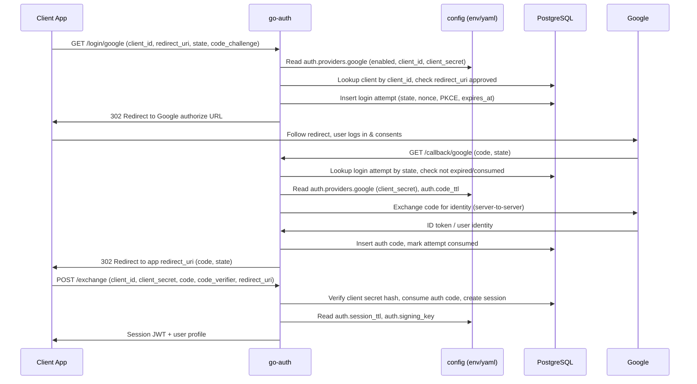

# Google Login Flow

## TL;DR
- **Goal:** Document how the existing Google OAuth login flow works, end to end.
- **Key decision:** PKCE + state protect the browser-facing hops; `/exchange` is a separate server-to-server step authenticated by client credentials.
- **Impact:** No code change — reference doc for `internal/service/login.go`, `callback.go`, `exchange.go`.

## Sequence

## Scope

### In scope
| Item | Readiness | Basis / action |
|---|---|---|
| Google login happy path | **Ready** | Matches `Login`, `Callback`, `Exchange` in `internal/service`. |

### Out of scope
- GitHub login flow (same shape, different provider client).
- Error/denial paths (expired attempt, access_denied, invalid client) — not diagrammed here.

## Data touched

| Step | Table / config key | Purpose |
|---|---|---|
| `/login` | `clients` (read) | Validate `client_id`, check `redirect_uri` is approved. |
| `/login` | `login_attempts` (insert) | Bind `state`, `nonce`, PKCE challenge, expiry to this attempt. |
| `/login` | `auth.providers.google.*` (config) | Provider enabled flag, OAuth client id/secret. |
| `/callback` | `login_attempts` (read + update) | Find attempt by `state`, mark consumed. |
| `/callback` | `auth_codes` (insert) | One-time code handed back to the client app. |
| `/callback` | `auth.code_ttl` (config) | Auth code expiry. |
| `/exchange` | `clients` (read) | Verify client secret hash. |
| `/exchange` | `auth_codes` (read + update) | Consume the one-time code. |
| `/exchange` | `sessions` (insert), `users` (read) | Create session, load profile for the response. |
| `/exchange` | `auth.session_ttl`, `auth.signing_key.*` (config) | Session lifetime and JWT signing key. |

## Behavior
- **PKCE + state** protect `/login` → Google → `/callback` from authorization code interception.
- **`/callback`** only talks to Google and the DB; it never sees the client secret.
- **`/exchange`** is server-to-server: the client app's backend authenticates with `client_id`/`client_secret` and proves it initiated the flow via `code_verifier`.
- The one-time auth code from `/callback` is single-use and short-lived (`AUTH__CODE_TTL`), separate from the session JWT lifetime (`AUTH__SESSION_TTL`).

## Risks / assumptions
- **Assumption:** Readers want the happy path only, not every denial/error branch. **If false:** add a second diagram for the error/expiry paths.
