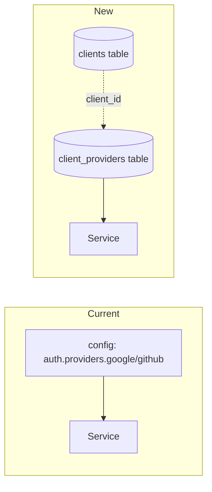
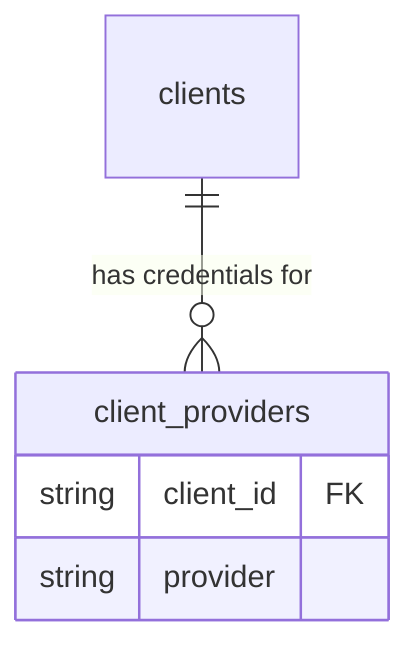

# Provider Credentials Per Client

## TL;DR
- **Goal:** Move OAuth provider credentials (Google/GitHub `client_id`/`client_secret`/`redirect_url`/`scopes`) out of static config into PostgreSQL, scoped per first-party `client_id`.
- **Key decision:** Each app (client) gets its own row per provider in a new `client_providers` table. Secrets are encrypted at rest, not hashed, because go-auth must send the plaintext back to Google/GitHub during code exchange.
- **Impact:** `config.AuthConfig.Providers` is removed; `internal/service` reads provider credentials from the DB per request instead of once at startup.

## Current vs. new

One global provider config today; one row per `(client_id, provider)` after this change.

## Data model

New table `client_providers`:

| Column | Type | Notes |
|---|---|---|
| `id` | UUID PK | app-generated UUIDv7, matches existing convention |
| `client_id` | VARCHAR(64) | FK → `clients.client_id` |
| `provider` | VARCHAR(32) | `"google"` \| `"github"` |
| `provider_client_id` | VARCHAR(255) | plaintext, not secret |
| `provider_client_secret_enc` | TEXT | AES-GCM encrypted, not hashed (must be reversible) |
| `redirect_url` | TEXT | callback URL registered with the provider for this client |
| `enabled` | BOOLEAN | replaces `ProviderConfig.Enabled` |
| `created_at`, `updated_at` | TIMESTAMPTZ | existing convention |

`UNIQUE (client_id, provider)`.

## Scope

### In scope
| Item | Readiness | Basis / action |
|---|---|---|
| `client_providers` table + migration | **Ready** | Follows existing `clients`/`login_attempts` migration conventions. |
| Repository lookup `GetClientProvider(ctx, clientID, provider)` | **Ready** | Replaces `AuthConfig.Providers` map read in `supportedProvider`. |
| Remove `AuthConfig.Providers` / `ProviderConfig` from `config` package | **Ready** | No longer global; config keeps `issuer`, TTLs, `signing_key`. |
| Secret encryption at rest | **Assumption — review** | Assume AES-GCM with a single encryption key from env (`AUTH__PROVIDER_SECRET_KEY`), same pattern as `signing_key`. **If false** (e.g. team wants GCP KMS envelope encryption instead): swap the encrypt/decrypt call only, schema (`provider_client_secret_enc TEXT`) stays the same. |
| Managing credentials (create/update per client) | **Ready** | `PUT /api/admin/v1/clients/:client_id` and `PUT /api/admin/v1/clients/:client_id/providers/:provider` added. Gated by a bearer JWT (`aud` == issuer, verified against the existing signing key) carrying a `role: "admin"` claim -- no admin account/role system yet, upgrade later. |

### Out of scope
- Moving `issuer`, TTLs, or `signing_key` to the database (confirmed out of scope — these are service-level, not per-client).
- Building a full admin UI for managing clients/providers.
- GitHub-specific changes beyond mirroring the Google row shape.

## Review decisions
| Decision | Why |
|---|---|
| Encrypt, not hash, provider secrets | go-auth must present the plaintext secret to Google/GitHub token endpoints during exchange; hashing is irreversible. |
| Keep `issuer`/`signing_key`/TTLs in config | These describe go-auth itself, not a per-client relationship — no reason to duplicate per row. |
| One encryption key for all rows (assumption) | Simplest to operate; rotating it means re-encrypting all rows. Acceptable for current scale; revisit if compliance requires per-tenant keys. |

## Behavior
- **Lookup becomes per-request:** `supportedProvider` queries `client_providers` by `(client_id, provider)` instead of reading an in-memory map populated at startup.
- **Unknown or disabled pairing fails the same way** as today's "unsupported provider" error — no new error category.
- **Callback URL is per client:** `redirect_url` used when building the provider authorization/exchange request comes from the matched row, not a single config value.
- **Startup no longer requires provider env vars**; a client with no `client_providers` row simply can't use that provider.

## Impact
- **Services:** No external API contract change — `/login`, `/callback`, `/exchange` keep the same request/response shape. New `/api/admin/v1/*` routes added.
- **Data:** New table + migration; existing Google/GitHub credentials currently in `.env` must be backfilled as rows for whichever `client_id` they belong to via the new admin endpoints (manual one-time data migration, not automatic).
- **Operational:** Provider credential rotation becomes a DB write (`PUT /api/admin/v1/clients/:client_id/providers/:provider`) instead of a redeploy.
- **Security:** Introduces a new secret class (encryption key) that must be protected at least as carefully as the signing key today. Admin routes currently trust any valid JWT carrying `role: "admin"` — anyone who can mint one (today: anyone holding the signing key material) can manage clients; revisit before this is exposed beyond trusted operators.

## Risks / assumptions
- **Assumption:** AES-GCM with one env-provided key is an acceptable encryption approach for now. **If false:** revisit before implementation — swapping to KMS later means a data migration (re-encrypt all rows), not just a code change.
- **Assumption:** A bearer JWT with a `role: "admin"` claim is an acceptable interim admin gate. **If false:** replace `requireAdminJWT` with real admin accounts/roles before relying on this in production.
