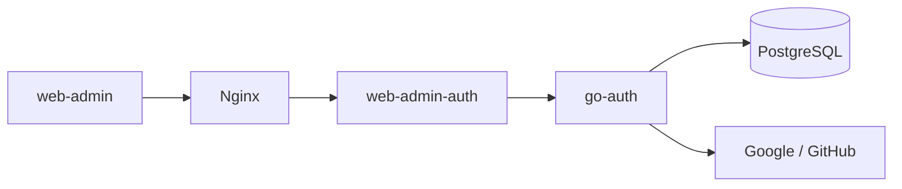

# SMB auth core rebuild

## TL;DR

- **Goal:** Align `go-auth` with the simplified database, then integrate and deploy its technical console.
- **Key decision:** The backend contract leads; use direct roles and the existing nine-table schema.
- **Impact:** `go-auth`, the `web-admin-auth` cookie adapter, `web-admin`, and `infra`.

## One technical core

Provider callbacks also enter `go-auth` through Nginx. Redis stays optional.
Security, correct data, stable contracts, and operations precede product
features. UI exposes real resources.

## What must change

| Evidence from the workspace                                         | Required outcome                                                   |
| ------------------------------------------------------------------- | ------------------------------------------------------------------ |
| Admin SQL still uses removed tables and columns.                    | Every enabled endpoint runs against the simplified schema.         |
| Client upsert and IAM use different admin gates.                    | One session-based admin policy with direct role assignments.       |
| UI expects groups, permissions, audit rows, and separate providers. | Console follows supported backend resources.                       |
| Infra uses stale provider env vars, `latest`, and local HTTP.       | Verified config, tagged images, target-specific TLS, and recovery. |

## Scope

### In scope

| Outcome                              | Readiness               | Basis / action                                                                                                                             |
| ------------------------------------ | ----------------------- | ------------------------------------------------------------------------------------------------------------------------------------------ |
| Schema-aligned auth/admin contracts  | **Ready**               | Preserve registration isolation, PKCE, sessions, profiles, direct roles.                                                                   |
| First-client/admin bootstrap         | **Ready**               | Private operator action; no public setup route or first-login privilege grant.                                                             |
| Cookie adapter and technical console | **Ready**               | Existing adapter is required for browser sessions and CSRF.                                                                                |
| Release preparation and smoke checks | **Ready**               | Existing Compose/Nginx is the delivery base.                                                                                               |
| Admin policy                         | **Assumption — review** | Direct `admin` role grants console administration. If false, revise role rules before writes. Please consider this default.                |
| Fresh install                        | **Assumption — review** | Earlier flattening spec records no deployment. Recheck target/data before SQL; if false, design a forward migration.                       |
| Live rollout                         | **Blocker**             | Target Docker host/context, public origin/TLS, secrets, provider registrations, and database state are unverified. Do not guess them.      |
| Requested CLI workflow               | **Blocker**             | Agy failed to start in this sandbox; no Claude delegation occurred. Use the prepared handoff in a terminal that supports its local server. |

### Out of scope

Enterprise tenants, groups, permission builders, separate provider storage,
persisted audit UI, user blocking, identity unlink/merge, public OAuth server
features, business workflows, Kubernetes/GCP migration, and new unit tests.

## Decisions and invariants

- **Schema leads:** Remove unsupported API fields/routes; do not restore tables to keep old screens working. This is a coordinated breaking admin API change.
- **Admin access:** Validate client-bound active sessions and current direct roles. Revoke access on role removal; protect the last admin transactionally. Query errors fail closed.
- **Auth stays intact:** Preserve state, nonce, S256 PKCE, exact redirects, single use, expiry, client UUID audience, and identity ownership. Never merge by email alone.
- **Secrets stay server-side:** Encrypt provider secrets, hash backend secrets, and keep tokens in HttpOnly cookies through the adapter. No stored secrets in responses or logs.
- **UI follows evidence:** Show users, identities, direct roles, sessions, and registrations. Show no invented status, device data, analytics, or audit history.

## Delivery order

| Phase                        | Gate                                                                       |
| ---------------------------- | -------------------------------------------------------------------------- |
| 0. Baseline and contract     | Record user edits, target assumptions, and the agreed API delta.           |
| 1. Auth and admin foundation | Fresh-schema HTTP checks, safe bootstrap, one admin gate.                  |
| 2. Core resource API         | Pagination, roles, registrations, and revocation pass SQL/HTTP checks.     |
| 3. Console integration       | Cookie/CSRF and real admin actions work; frontend checks pass.             |
| 4. Infra and release         | Tagged images, target/config, backup, readiness, smoke, rollback evidence. |

Agy reviews gates; Claude implements bounded tasks. Require execution evidence.
See [contracts](01-core-contract.md),
[delivery gates](02-delivery-phases.md), and [agy handoff](03-agy-orchestrator.md).

> **Data safety:** Never replay edited initial SQL over an existing deployment,
> run the initial down migration for rollback, or delete persistent volumes.

## Spec precedence and current status

This rebuild plan keeps the [flattened client model](../2026-10-17-flatten-oauth-clients.md)
and supersedes conflicting provider-table, permission, and group designs.
Compatible older security rules remain. Runtime work and deployment are pending.
