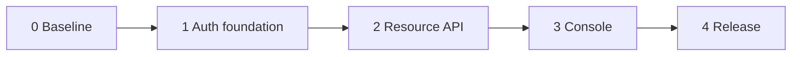

# Delivery phases and exit gates

## TL;DR

- **Goal:** Deliver a usable backend core, then its console and runtime stack.
- **Key decision:** Agy reviews each gate; Claude implements bounded tasks.
- **Impact:** Coordinated API, adapter, frontend, and infra release.

## Scope and order

**In scope — Ready:** Phases 0–3 and release preparation.
**In scope — Blocker:** Live deployment until the target prerequisites below
are verified, and CLI execution until agy can start.
**Out of scope:** Product features and enterprise IAM; see [scope](00-overview.md).

Each phase may contain several small Claude tasks. Agy sets task scope, reviews
the diff and check evidence, and resolves regressions before advancing. It can
prepare later work while a prerequisite is blocked; it cannot claim the later
gate passed. One repo writer at a time preserves the existing user changes.

## Phase 0: baseline and contract

**Agy owns:** Inspect repo instructions and dirty state, then record the schema,
API delta, consumers, and deployment facts. Split the phases into tasks whose
results can be reviewed independently. Treat the existing uncommitted edits and
untracked IAM/UI files as user work to preserve and extend.

**Claude delivers:** Resolve stale README/AGENTS guidance as facts become known;
keep a contract shared by backend, adapter, and UI. The planning documents here
are the starting handoff, not evidence of an agy or Claude implementation run.

**Exit gate:** Schema/route delta is explicit; frontend calls are mapped to it;
bootstrap and admin policy are defined; existing data/consumer assumptions are
recorded. Each task names allowed repos, checks, dependencies, and a pass/fail
result. No DB reset or dependency upgrade is hidden in the baseline.

## Phase 1: auth and admin foundation

**Claude delivers:** Preserve the working registration-based login path; align
session authentication and admin access with the current schema. Replace the
permission/group gate and temporary custom-admin-JWT upsert gate with the
direct-role policy. Provide explicit private first-client and first-admin
bootstrap, with no unauthenticated setup route or automatic first-user admin.
Validate callback URLs and secrets before storage. Retire incompatible routes
until their schema-aligned replacement is ready; fail closed throughout.

**Exit gate:** A disposable fresh database accepts the initial schema. Initial
client setup, login, code exchange, `/me`, profile update, and logout work.
Bootstrap is repeatable without overwriting another administrator. Missing,
expired, revoked, disabled-client, wrong-provider, and wrong-registration
credentials cannot gain admin access. A valid non-admin gets an honest denied
state. Build and vet pass; no removed-schema query runs on these paths.

**Boundary:** Roles remain direct user assignments. Do not introduce permission
tables, public token minting, signup products, or account merging.

## Phase 2: core resource API

**Claude delivers:** Complete the [resource contract](01-core-contract.md) for
users, identities, roles, sessions, and registrations. Use schema-backed fields,
nullable email handling, bounded pagination, stable ordering, validated writes,
and safe errors. Consolidate client writes around encrypted provider secrets
and hashed backend secrets. Remove obsolete handlers and their consumers.
Protect reserved `admin` and the last-admin invariant under concurrent writes.
Emit safe correlated operation logs without creating an audit table.

**Exit gate:** Exercise every supported read/write against the fresh schema.
Role replacement is atomic; unknown IDs change nothing; concurrent changes
cannot leave zero admins. Role removal denies the next admin request using the
same session. Session revocation takes effect on the next protected request.
Client upsert preserves its UUID; disabling it rejects login and protected use.
Raw stored secrets, SQL errors, and unsupported fields never reach responses.

**Checks:** Format changed Go files; `go build ./...`; `go vet ./...`; live
HTTP/SQL cases below. A query error is a failed operation, never an empty list
or successful authorization. Do not add unit tests.

## Phase 3: cookie adapter and technical console

**Claude delivers, in order:** Verify the adapter preserves client/session
headers, queries, status codes, and bounded bodies. Make origin policy explicit
for local versus deployed use. Keep credentials server-side and cover mutations
with CSRF. Then align UI types, calls, navigation, forms, and translations with
the accepted API. Remove groups, permission builders, separate provider CRUD,
fake analytics, and unsupported actions. Preserve valid existing layouts and UI
work; refactor only what is needed to consume the core.

**Exit gate:** Browser login passes through provider callback, product callback,
HttpOnly session, access lookup, and admin navigation. A non-admin sees access
denied. Role assignment, revoke, upsert, and disable reflect actual API results.
Missing/bad CSRF and disallowed Origin fail before writes. No JWT or backend
credential appears in browser storage, URLs, or logs. Forms handle pending,
empty, denied, error, and success; keyboard and direct route loading work.

**Checks:** Adapter `go build ./...` and `go vet ./...`; frontend
`bun run type-check`, `bun run lint`, `bun run build`; Prettier on changed files.
Inspect behavior without screenshots. Verify no removed route is still called.

## Phase 4: infra, release, and recovery

**Claude prepares:** Correct auth env examples to per-registration secrets;
include the encryption-key variable; remove references to absent bootstrap
commands. Build backend, adapter, and frontend images with immutable release
tags; use those tags in Compose. Align issuer, provider callbacks, approved
product redirects, origin, TLS, cookies, and trusted proxies. Add meaningful
health/startup gates. The scratch backend image needs a probe that actually
exists; do not assume it contains a shell, curl, or wget.

Define an explicit one-time migration/bootstrap procedure, with a migration
record and target checks. Include readiness/schema smoke checks: a successful
database ping alone is insufficient. Keep volumes, internal DB/ops access,
existing network topology, and unrelated service routes intact. Validate
Nginx includes and upstream names in the actual image before reload.

**Live target prerequisites:** Identify the Docker host/context, release tags
or image registry, public origin/TLS endpoint, provider-console registrations,
approved redirects, secret/key availability, current schema/data, and who can
restore the database. None of these is established by a folder named `prod`.
Ask only for missing facts after completing safe preparation; do not repeat
authorization that the user already supplied.

**Rollout:** Prepare a backup and verified restore path for existing data.
On a proven fresh target, apply initial up SQL once. On an existing target,
stop only the migration-dependent work and prepare a forward migration after
inventory; never replay initial SQL. Start database/core, bootstrap privately,
then adapter/frontend and gateway. Keep ingress limited until smoke checks pass.
Inspect actual readiness, callback routing, admin access, and revocation through
the gateway. Record exact image tags and results; do not announce success from
container startup alone.

**Rollback:** Keep previous compatible images/config and all required keys.
Switch images only when schema compatibility is proven; otherwise use the
reviewed forward-fix or restore plan with a controlled write pause. Preserve
client UUIDs and key material; unexpected replacement can invalidate sessions
or make stored provider secrets unreadable. Never use `down -v` or the initial
down SQL to undo a release.

## Acceptance matrix for the release

| Case                                         | Required result                                                                                                                        |
| -------------------------------------------- | -------------------------------------------------------------------------------------------------------------------------------------- |
| Fresh SQL and every enabled API              | No missing table/column error; nullable data and empty lists work.                                                                     |
| Google and GitHub auth core                  | Success with configured registrations; invalid state, nonce, redirect, expiry, and PKCE rejected. Browser adapter remains Google-only. |
| Callback/code replay and parallel exchange   | At most one successful consumption; no extra usable session.                                                                           |
| Cross-registration and wrong-provider access | Denied even when external client IDs match.                                                                                            |
| No session, non-admin, role-query failure    | 401, 403, safe 5xx respectively; no privileged write.                                                                                  |
| Last-admin and role replacement races        | At least one admin remains; no partial assignment.                                                                                     |
| Session revoke, expiry, client disable       | Next protected call denied; repeat revoke safe.                                                                                        |
| Browser mutations                            | Valid cookie/Origin/CSRF required; forged headers cannot replace backend credentials.                                                  |
| Database unavailable                         | Readiness fails; existing API fails safely; no false success.                                                                          |
| Provider unavailable                         | New login fails safely; existing valid-session reads remain usable with database available.                                            |
| Gateway/TLS/direct routes                    | Real origin, cookies, callbacks, and SPA fallback work; internal services stay private.                                                |
| Rollback exercise                            | Known images/config and a verified compatible data recovery path.                                                                      |

Run manual or integration HTTP/SQL checks against disposable data; do not write
unit tests. Record skipped checks and external prerequisites honestly.

## Current execution status

Planning/docs prepared on 2026-10-17. Runtime implementation, builds, browser
smoke, migrations, and deployment have not been performed in this planning
update. Agy exited 1 before starting: the sandbox denied its localhost listener
(`bind: operation not permitted`). Claude was not invoked. The
[handoff](03-agy-orchestrator.md) preserves the requested workflow for a suitable
terminal. No automatic fallback agent was used.

Planning checks passed: Prettier on all ten changed Markdown files; 38 local
links and balanced code fences; 234 existing non-doc file fingerprints unchanged
(secret files excluded). All three relevant Compose manifests passed structural
validation with `--env-file /dev/null`, `--no-interpolate`, and
`--no-env-resolution`. These checks do not validate Nginx runtime, application
behavior, or deployment readiness.

## Advanced: deployment evidence inspected

- [Auth Compose](../../../infra/clusters/prod/go-auth/docker-compose.yaml):
  `latest`, persistent DB/Redis volumes, startup order, no migration job.
- [Admin Compose](../../../infra/clusters/prod/web-admin/docker-compose.yaml):
  frontend and cookie adapter on `global`.
- [Admin virtual host](../../../infra/clusters/prod/gateway/nginx/conf.d/admin.anlew.conf):
  local HTTP, adapter API proxy, direct provider callback routes.
- [Auth env example](../../../infra/clusters/prod/go-auth/go-auth/.env.example):
  stale global provider variables; encryption key absent.
- [Origin policy](../../../web-admin-auth/internal/server/guards.go):
  local allowlist is currently accepted alongside configured origin.
- [Backend image](../../deploy/Dockerfile): scratch runtime, non-root user,
  no migrations or shell probe included.
